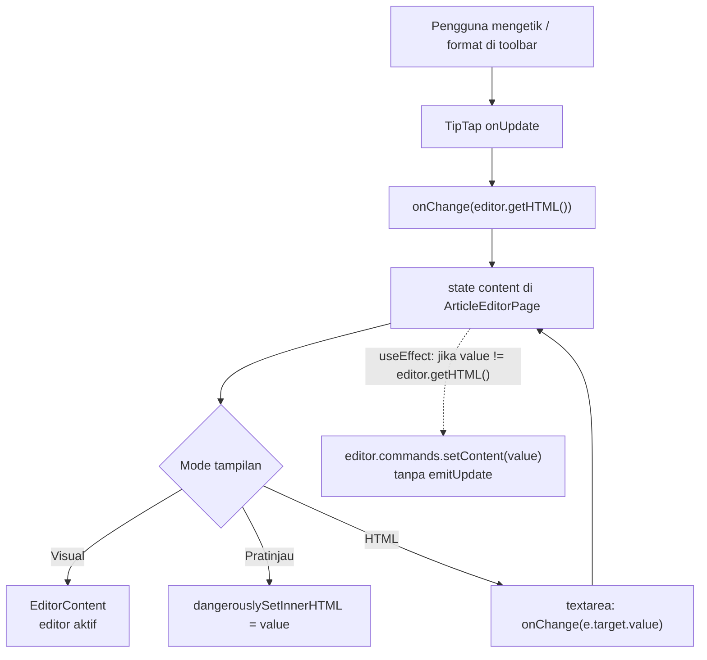
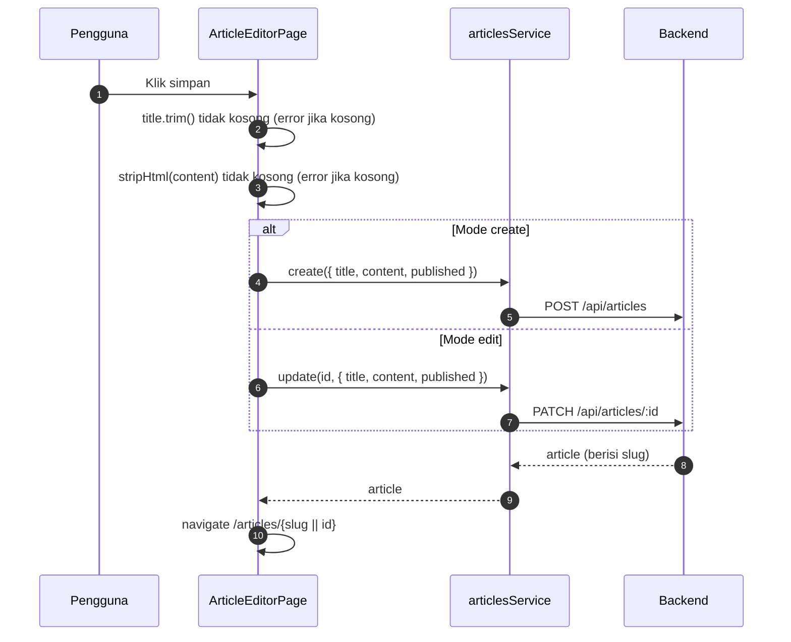
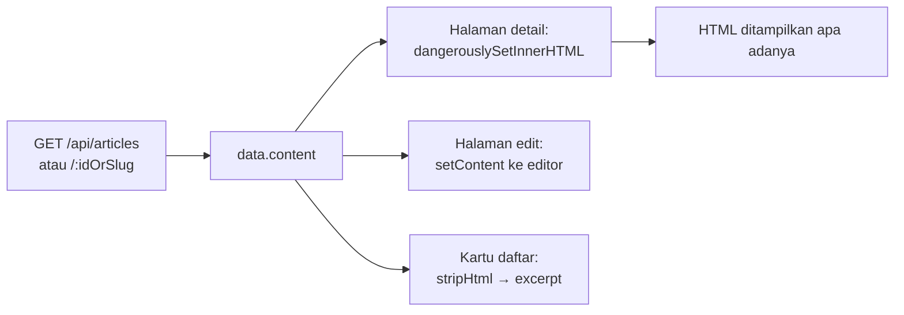

# Alur Penyimpanan Artikel WYSIWYG (Frontend)

Dokumen ini menjelaskan bagaimana editor WYSIWYG (TipTap) menghasilkan konten artikel, bagaimana konten dikirim ke API, dan bagaimana konten dirender kembali. Sisi backend ada di `kdpl-tubes-backend/docs/article-content-flow.md`.

## Ringkasan

- Editor: **TipTap 3** (`@tiptap/react`, `@tiptap/starter-kit`) dengan extension tambahan: Underline, Highlight, Link, TextAlign, Placeholder.
- Format konten: **HTML** hasil `editor.getHTML()`. Tidak ada format JSON Tiptap atau Markdown.
- Konten disimpan di state React (`content`) dan dikirim sebagai string ke backend saat submit.
- Ada tiga mode tampilan di komponen editor: **Visual**, **Pratinjau**, dan **HTML** (textarea mentah).
- Frontend tidak menyanitasi HTML. Konten dirender dengan `dangerouslySetInnerHTML` di halaman detail dan pratinjau.

## File Terkait

| File                                       | Peran                                                            |
| ------------------------------------------ | ---------------------------------------------------------------- |
| `src/components/editor/wysiwyg-editor.tsx` | Komponen editor, toolbar, mode Visual/Pratinjau/HTML             |
| `src/pages/article-editor-page.tsx`        | Form judul, konten, status publish, validasi, submit create/edit |
| `src/services/articles.service.ts`         | `create`, `update`, `getByIdOrSlug` ke API                       |
| `src/pages/article-detail-page.tsx`        | Render konten artikel (`dangerouslySetInnerHTML`)                |
| `src/components/articles/article-card.tsx` | Excerpt kartu dari `stripHtml(content)`, badge Draft             |
| `src/lib/utils.ts`                         | `stripHtml()` (regex, membuang tag)                              |

## Alur Editor

Dua arah sinkronisasi:

- Visual → state: setiap perubahan di TipTap memanggil `onChange` dengan HTML terbaru.
- State → Visual: jika `value` dari luar berbeda dengan HTML editor, `setContent` dipanggil tanpa memicu `onUpdate`. Ini mencegah loop.

Mode HTML mengubah `value` langsung tanpa melewati TipTap. Saat kembali ke Visual, TipTap mem-parse HTML tersebut. Tag atau atribut yang tidak dikenal TipTap bisa hilang atau berubah.

Mode Visual dan Pratinjau dinonaktifkan untuk tombol format saat berada di mode selain Visual.

## Alur Simpan

Catatan:

- Validasi kosong di frontend memakai `stripHtml(content)`. Konten yang hanya berisi `

` dianggap kosong.
- `title` dikirim sudah di-`trim()`.
- Setelah sukses, navigasi memakai `slug`. Jika `slug` kosong, dipakai `id`.
- Error dari server ditampilkan lewat `ApiError.message`.

## Alur Baca

Halaman edit memuat konten lewat `GET /api/articles/:idOrSlug` lalu mengisi state `content`. Pengecekan izin edit dilakukan dengan `canEditOrDelete()` sebelum form tampil.

## Yang Tidak Dilakukan Frontend

| Aspek                                                                 | Status                                       |
| --------------------------------------------------------------------- | -------------------------------------------- |
| Sanitasi HTML sebelum render                                          | Tidak ada                                    |
| Batas panjang judul atau konten                                       | Tidak ada (hanya cek kosong)                 |
| Auto-save / draft lokal                                               | Tidak ada                                    |
| Konfirmasi saat meninggalkan halaman dengan perubahan belum tersimpan | Tidak ada                                    |
| Penyimpanan konten di `localStorage`                                  | Tidak ada                                    |
| Filter draft di daftar artikel                                        | Tidak ada. Draft tampil dengan badge `Draft` |

## Peringatan Keamanan

> **Stored XSS.** Halaman detail dan pratinjau merender HTML dari server dengan `dangerouslySetInnerHTML`. Mode HTML di editor menerima tag dan atribut apa pun. Jika backend tidak menyanitasi, payload seperti `` akan dieksekusi di browser pembaca. Tambahkan sanitasi (misal DOMPurify) sebelum render di `article-detail-page.tsx` dan di mode Pratinjau `wysiwyg-editor.tsx`.

Risiko lain:

- `window.prompt` dipakai untuk URL tautan. Tidak ada validasi tambahan selain default `@tiptap/extension-link`. Verifikasi bahwa skema `javascript:` ditolak sebelum mengandalkannya.
- `stripHtml` berbasis regex. Hasilnya hanya untuk excerpt dan validasi kosong, bukan untuk keamanan.

## Terkait

- Alur penyimpanan dan validasi backend: `kdpl-tubes-backend/docs/article-content-flow.md`
- Alur autentikasi frontend: `docs/authentication.md`
