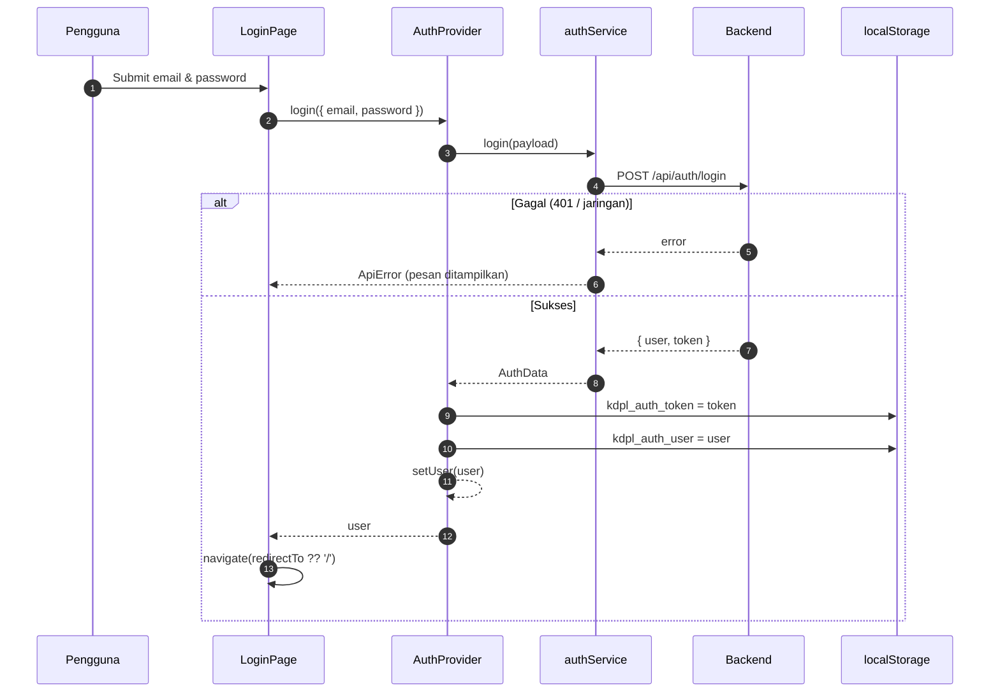
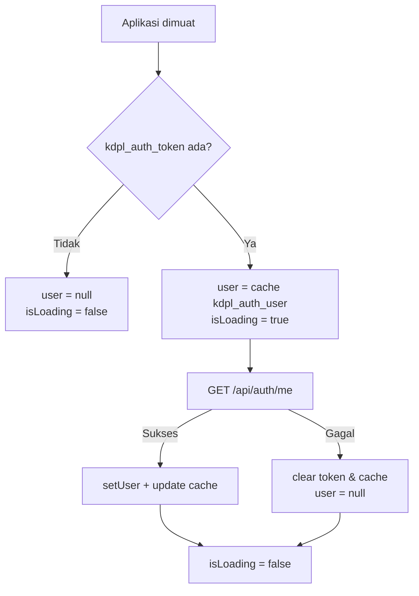
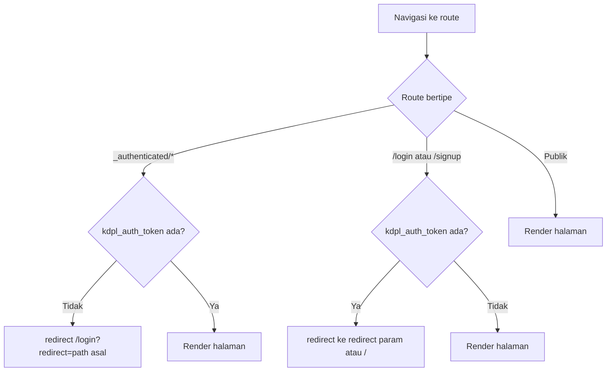
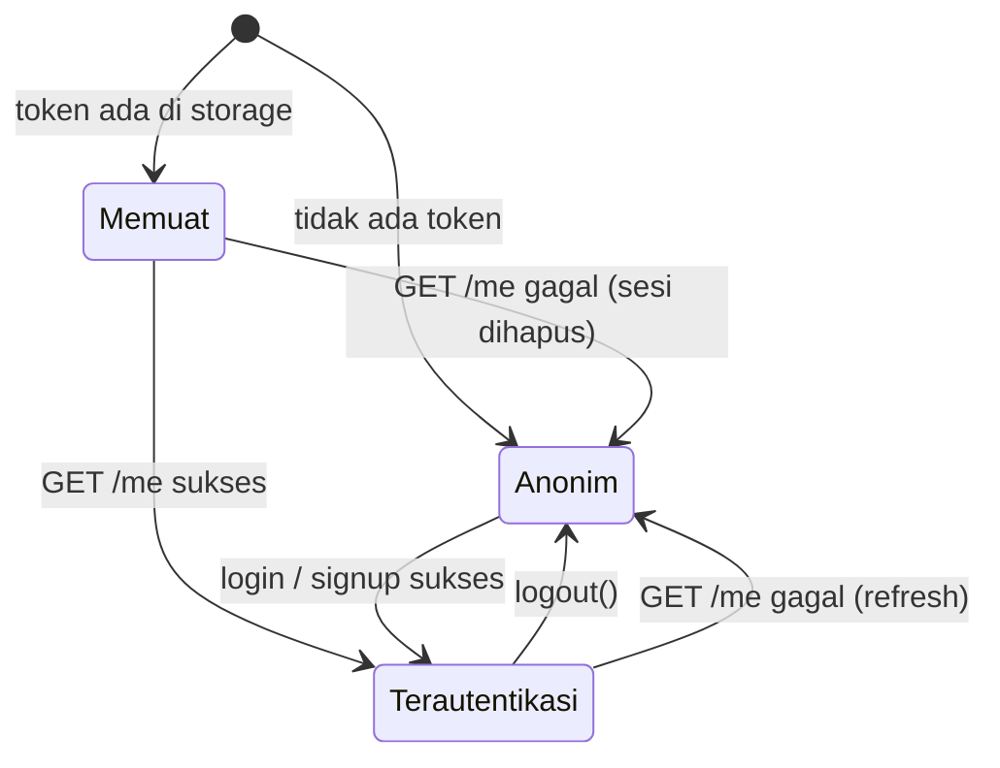
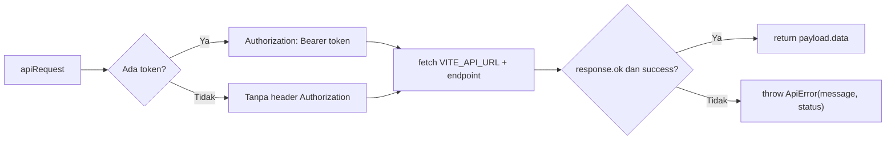

# Autentikasi & Manajemen Sesi (Frontend)

Dokumen ini menjelaskan bagaimana aplikasi React (TanStack Router + Context) mengelola login, signup, token, dan proteksi route. Detail sisi server ada di `kdpl-tubes-backend/docs/authentication.md`.

## Ringkasan

- Token JWT dan data user disimpan di `localStorage`.
- State auth dikelola `AuthProvider` (`src/context/auth-context.tsx`) dan dibaca lewat `useAuth()`.
- Route yang butuh login dilindungi `beforeLoad` pada layout route `_authenticated`.
- Setiap request ke API otomatis menyertakan `Authorization: Bearer <token>` (`src/services/api-client.ts`).
- Otorisasi edit/hapus artikel di UI hanya untuk tampilan. Backend tetap memvalidasi.

## File Terkait

| File                                            | Peran                                                         |
| ----------------------------------------------- | ------------------------------------------------------------- |
| `src/services/api-client.ts`                    | Get/set/clear token, `apiRequest` (header Bearer, `ApiError`) |
| `src/services/auth.service.ts`                  | Panggilan `signup`, `login`, `getMe`                          |
| `src/context/auth-context.tsx`                  | `AuthProvider`, `useAuth`, cache user, `canEditOrDelete`      |
| `src/routes/_authenticated.tsx`                 | Guard route privat                                            |
| `src/routes/login.tsx`, `src/routes/signup.tsx` | Redirect jika sudah login                                     |
| `src/components/layout/navbar.tsx`              | Tombol logout                                                 |

## Penyimpanan

| Key `localStorage` | Isi                                    | Diatur oleh                           |
| ------------------ | -------------------------------------- | ------------------------------------- |
| `kdpl_auth_token`  | JWT dari server                        | `setStoredToken` / `clearStoredToken` |
| `kdpl_auth_user`   | Objek `User` (cache untuk render awal) | `setCachedUser` di `AuthProvider`     |

Cache `kdpl_auth_user` hanya untuk tampilan awal. Data yang sebenarnya diverifikasi lewat `GET /api/auth/me` saat aplikasi dimuat.

## Alur Login

Signup (`SignupPage`) mengikuti alur yang sama, memanggil `signup()` dan langsung menyimpan token dari respons. Setelah berhasil, user diarahkan ke `/`.

## Inisialisasi Sesi Saat Aplikasi Dimuat

## Proteksi Route

Guard hanya memeriksa keberadaan token, bukan validitasnya. Token yang sudah expired akan lolos guard. Halaman tetap render sampai `GET /api/auth/me` gagal, lalu `refreshUser()` menghapus sesi. Nilai `isLoading` dari `useAuth()` tidak dipakai guard maupun halaman.

## Logout

1. `Navbar` memanggil `logout()`.
2. `logout()` menghapus `kdpl_auth_token` dan `kdpl_auth_user`, lalu `user = null`.
3. `navigate({ to: '/' })`.

Tidak ada panggilan ke server. Token lama tetap valid di server sampai expired.

## Status Sesi

## Pengiriman Request ke API

- Base URL diambil dari `VITE_API_URL` (contoh: `http://localhost:8787`).
- Error dari server ditampilkan lewat `ApiError.message`.
- Respons 401 dari endpoint lain tidak memicu logout otomatis. Sesi dihapus hanya saat `GET /api/auth/me` gagal.

## Otorisasi di UI

`canEditOrDelete(article)` menentukan apakah tombol edit/hapus muncul:

- `admin` selalu `true`.
- Selain itu, `true` jika `article.author.id` (atau `authorId`) sama dengan `user.id`.

Pengecekan ini hanya untuk tampilan. Backend tetap menolak aksi yang tidak diizinkan (403).

## Peringatan Keamanan

- **Token di `localStorage`** dapat dibaca skrip apa pun yang berjalan di halaman. Celah XSS bisa membocorkan token.
- **Guard tidak memvalidasi token.** Token expired tidak langsung memaksa logout sampai `/me` dipanggil.
- **Tidak ada penanganan 401 global.** Request lain yang gagal karena token expired hanya menampilkan error.
- **Cache `kdpl_auth_user` bisa basi** (misal role berubah di server) sampai `/me` selesai.

## Terkait

- Alur autentikasi di sisi backend: `kdpl-tubes-backend/docs/authentication.md`
